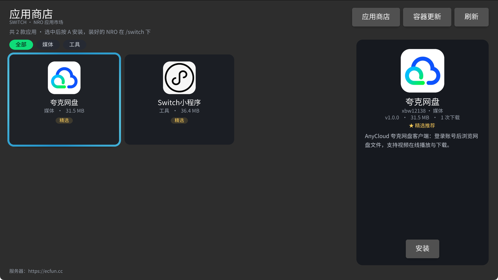
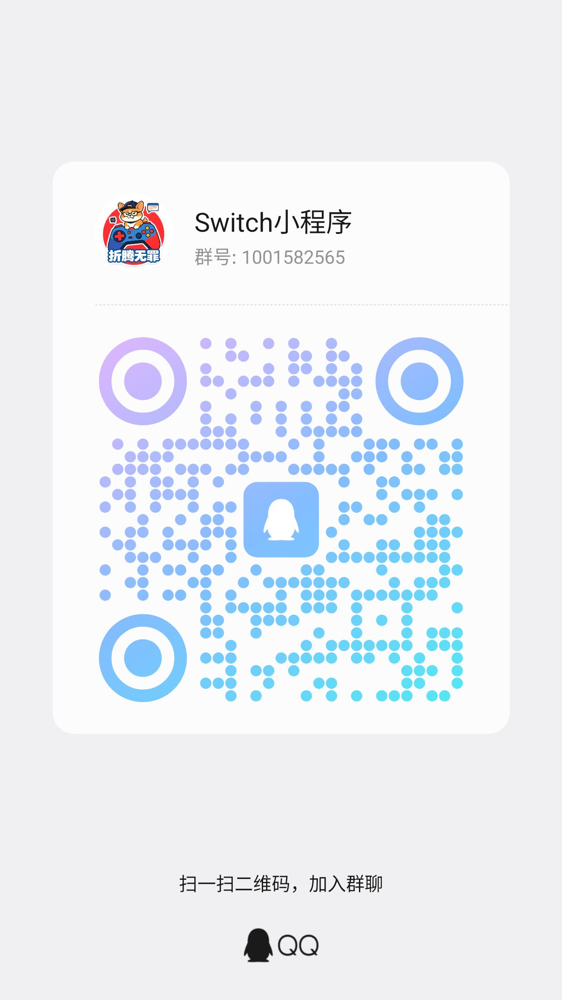

<div align="center">

# NXMiniApp

**运行于 Nintendo Switch 的小程序容器**

原生渲染 · 类微信小程序生态 · 独立于 NXKit 维护

[](https://ecfun.cc)
[](#客户端)
[](#服务端docker-推荐)
[](#社区交流)

</div>

---

## 项目简介

NXMiniApp 让小程序在 Switch 上原生运行：一套代码，同时覆盖 Switch 真机与桌面端。内置商店式启动器，支持在线下载、安装与管理小程序。

```
NXMiniApp/
├── client/            # Switch / 桌面客户端（borealis 原生渲染）
│   ├── apps/miniapp/  # 容器应用：商店式启动器 + 小程序运行时
│   ├── core/          # NXKit 核心（HTTP、配置、UI 组件）
│   ├── library/       # borealis / QuickJS / Yoga 等
│   └── resources/     # 字体、图标、示例小程序包
├── docs/              # 小程序开发文档站（组件 / 样式 / API / 指南）
├── server/            # Go + Gin + GORM + MySQL 服务端与管理后台
└── docker-compose.yml # MySQL + 服务端一键启动
```

## 能力一览

小程序能力手册在 [docs/index.html](docs/index.html)，按微信官方文档的结构组织：指南、组件、样式、API、参考。直接双击打开即可，也可以起一个静态服务：

```bash
python3 -m http.server 8090 --directory docs
# 打开 http://127.0.0.1:8090
```

当前对齐范围（与微信对比）：

| 能力 | 支持情况 |
| --- | --- |
| 内置标签 | 22 类（含 scroll-view / swiper / 表单控件 / progress / rich-text / icon / video） |
| 模板指令 | `wx:for` / `wx:if` / `wx:elif` / `wx:else` |
| JS 运行时 | 完整常驻运行时与 `setData` |
| 页面导航 | 页面栈与路由 |
| 交互事件 | 鼠标左键与触摸点击（`bindtap` 冒泡 / `catchtap` 终止） |
| API | 36 个可用的 `wx.*` API，18 个兼容占位接口 |
| 视频播放 | Switch 构建（默认 `NXKIT_WITH_MPV=ON`）真实播放，桌面构建需安装 libmpv 后开启 |

详细边界见文档的「与微信的差异」。

## 服务端（Docker，推荐）

```bash
cd NXMiniApp
docker compose up --build -d
```

- API：`http://127.0.0.1:8080/api/v1/…`
- 管理后台：`http://127.0.0.1:8080/admin`
- 文档站：`http://127.0.0.1:8080/docs`（内容存 MySQL，可在后台「文档」页在线编辑；编辑后即时生效）
- 管理令牌：环境变量 `NXKIT_ADMIN_TOKEN`（默认 `nxkit-store-admin`）
- 首次启动自动建表，并把 `client/resources/miniapps` 下的示例小程序、`docs/` 下的文档页写入 MySQL（仅在对应表为空时执行；后台「文档」页的「恢复默认」可从镜像内置的 docs 目录还原单页）

数据：MySQL 存元数据，`server-data` 卷存安装包/图标/截图。

构建镜像时默认走国内源（npm → npmmirror、Go → goproxy.cn、Alpine → aliyun），可通过 `NPM_REGISTRY` / `GOPROXY_URL` / `APK_MIRROR` 构建参数覆盖：

```bash
docker compose build \
  --build-arg NPM_REGISTRY=https://registry.npmmirror.com \
  --build-arg GOPROXY_URL=https://goproxy.cn,direct
```

## 客户端

桌面预览（需要 CMake，borealis 依赖见 client/library）：

```bash
cd client
cmake -S . -B build_desktop -DPLATFORM_DESKTOP=ON \
  -DCMAKE_POLICY_VERSION_MINIMUM=3.5 -DPYTHON_EXECUTABLE=$(which python3)
cmake --build build_desktop --target miniapp -j 8
cd build_desktop/apps/miniapp && ./miniapp
```

- 启动后进商店式启动器，默认连 `http://127.0.0.1:8080`；可用 `NXKIT_MINIAPP_SERVER` 覆盖，或写进 `nxkit_data/config.json` 的 `miniapp.serverUrl`
- 点卡片下载安装并进入；`B` 返回启动器；最近使用置顶
- 跳过商店直接预览本地包：`NXKIT_MINIAPP_DEV=<包目录> ./miniapp`（仅桌面）

Switch 真机（需要 devkitPro）：

```bash
cd client
DEVKITPRO=/opt/devkitpro cmake -S . -B build_switch -DPLATFORM_SWITCH=ON \
  -DCMAKE_POLICY_VERSION_MINIMUM=3.5 -DPYTHON_EXECUTABLE=$(which python3)
cmake --build build_switch --target miniapp.nro -j 8
```

把 `build_switch/apps/miniapp/miniapp.nro` 放到 `sdmc:/switch/`，服务器地址写进 `sdmc:/switch/nxkit/config.json`。

## Switch 应用商店（updater.nro）

独立于容器的启动器：原生卡片墙商店 + 容器更新，首次推送后全程免插线。

<div align="center">
  
</div>

- 下载：[updater.nro](https://ecfun.cc/downloads/updater.nro)（约 14 MB），放到 `sdmc:/switch/` 后从 hbmenu 启动
- 源码：[client/apps/updater](client/apps/updater)
- 支持分类筛选、详情面板、一键安装；容器更新多段并行下载，先备份再替换，失败自动回滚
- 桌面预览：`cmake --build build_desktop --target updater -j 8 && ./build_desktop/apps/updater/updater`

## 社区交流

- 官网：[ecfun.cc](https://ecfun.cc)
- QQ 群：**1001582565**（Switch小程序），扫码加群一起交流：

<div align="center">
  
</div>

## 开源许可

本项目以 [GNU General Public License v3.0](LICENSE) 发布。

- 可自由使用、修改、分发，包括商业用途
- 分发修改版或编译产物时，必须同样以 GPL-3.0 开放对应源码并保留原作者署名
- 本项目不提供任何形式的担保

## 免责声明

- 本项目是个人开源的**非官方**项目，与 Nintendo 及其关联公司**没有任何关系**，未获得其授权、认可或赞助。
- Nintendo Switch、Nintendo 及相关名称、商标、标识归 Nintendo 所有，本项目仅在描述兼容性时提及。
- 本项目**不包含也不提供**任何游戏 ROM、系统固件、密钥或其它受版权保护的官方内容，亦不协助获取上述内容。
- 请仅在你**合法拥有的主机**上使用。使用前请自行评估风险，包括但不限于主机封禁、数据丢失、硬件损坏；**由此产生的一切后果由使用者自行承担**。
- 商店中的小程序由第三方开发者上传，其内容与合法性由上传者负责，本项目不对其安全性、合法性或可用性作任何担保。
- 本项目按「现状」提供，不附带任何明示或默示的担保。

## 第三方组件

`client/library` 下的依赖各自遵循其原始许可，不因本项目而改变：

| 组件 | 许可 |
| --- | --- |
| borealis | Apache-2.0 |
| OpenCC | Apache-2.0 |
| quickjs | MIT |
| yoga | MIT |
| lunasvg | MIT |
| cpr | MIT |
| pystring | BSD |
| QR-Code-generator | MIT |
| libsmb2 | LGPL-2.1 |
| mongoose | GPL-2.0 或商业授权（二选一） |

注意：客户端 `miniapp` / `updater` 静态链接了 mongoose，其 GPL-2.0 义务适用于据此构建的二进制产物；如需闭源分发，请自行向 Cesanta 购买 mongoose 商业授权。
